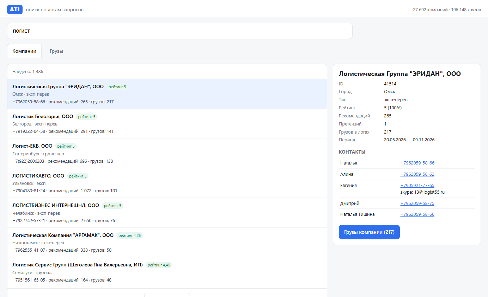

# ATI — поиск компаний в логах запросов

Статический сайт (GitHub Pages) для поиска компаний и грузов по логам запросов ATI,
собранным сервисом `bot_contacts`.

Работает целиком в браузере: нет бэкенда, нет базы данных, нет запросов на сервер —
только два JSON-файла с данными и немного JavaScript.



Адрес: <https://arseniys1.github.io/ati-company-search/>

## Что внутри

- 27 692 компании: название, город/регион, тип, рейтинг, рекомендации, претензии,
  документы, контакты (телефоны, e-mail, skype), число грузов и период активности.
- 196 148 грузов: маршрут, груз, вес/объём, ставка, расстояние, даты, компания.
- Период логов: 24.04.2026 — 11.11.2026.

Покрытие выгрузки (проверяется самим `tools/extract.py` при сборке):

```
logs              33199
load records     248798 ->  196148 unique loads
unique load ids  196150 ->  196148
companies         27692 ->   27692
companies with loads: 27690
```

Не попадают только 2 груза, у которых в логе вообще нет фирмы (`firmId` и
`firmInfo.id` пустые) — их не к чему привязать.

Важно про привязку грузов к компаниям: страница груза ATI отдаёт два разных id —
`firmId` (фирма, из-под которой открыли страницу) и `firmInfo.id` (владелец груза).
Владельцем считается `firmInfo.id`: он совпадает с `firm.id` того же груза в
результатах поиска. Привязка по `firmId` давала бы грузы чужой компании — так было
в первой версии выгрузки, когда 3 699 грузов числились не за своими фирмами.

Поиск идёт по одному полю: название компании, город, телефон (в том числе только цифры),
e-mail, ФИО контакта, груз, маршрут, номер груза.

## Чего в данных нет

Публикуются только данные ATI. Из дампа не экспортируется ничего, что относится
к пользователям сервиса:

- `web_users`, `tg_users`, `vk_users`, `support_agents`, `support_tickets`, `support_messages`;
- сессии и токены: `web_user_sessions`, `server_sessions`, `web_link_tokens`,
  `bot_link_tokens`, `email_verification_tokens`, `password_reset_tokens`;
- платежи и подписки: `payments`, `payment_methods`, `payment_provider_configs`,
  `subscriptions`, `subscription_plans`, `subscription_purchase_operations`,
  `refund_applications`, `refund_subscription_snapshots`, `legacy_subscription_transfers`,
  `yoomoney_manual_accounts`, `web_user_demo_accesses`;
- отпечатки и инфраструктура: `fingerprints`, `browser_infos`, `web_user_fingerprints`,
  `site_error_reports`, `notifications`, `site_user_favorites`, `site_user_filters`;
- учётные записи ATI сервиса: `ati_accounts`, `ati_accounts_data`, `ati_accounts_datas`;
- из `ati_request_logs` — `id`, `web_user_id`, `request_payload` (поисковые фильтры
  пользователя) и время запроса. Остаётся только содержимое ответов ATI: компании,
  их контакты и грузы.

## Структура

```
index.html            страница
assets/app.js         поиск и интерфейс
assets/worker.js      загрузка и поиск по грузам в Web Worker
assets/style.css      стили главной
assets/page.css       стили статических страниц компаний и каталога
data/companies.json   компании (2 МБ gzip)
data/loads.json       грузы, компактные строки + справочники городов и грузов (4 МБ gzip)
data/meta.json        счётчики и период логов
company/<id>.html     статическая страница каждой компании (27 692 шт.)
catalog.html          каталог по алфавиту
catalog/<буква>.html  список компаний на букву
sitemap.xml           все URL для поисковиков
robots.txt            разрешает обход и указывает на sitemap
tools/extract.py      сборка data/*.json из восстановленного дампа
tools/build_seo_pages.py  генерация company/, catalog/, sitemap.xml
tools/counters.py     пересчёт счётчиков выгрузки
```

Статические страницы компаний нужны для поисковиков: главная рисует результаты из JSON
в браузере, а робот видит только разметку. В `company/*.html` текст (название, город,
контакты, рейтинг, последние грузы) уже в HTML, с микроразметкой `Organization` и
перелинковкой с другими компаниями того же города.

`data/companies.json` — массив объектов. `data/loads.json` — объект:

```json
{
  "companies": ["3320602", "..."],
  "cities": ["Пермь", "..."],
  "cargos": ["Трубы", "..."],
  "rows": [[0, 12, 34, 1659, 5, 20, 0, 95000, 0, "2026-04-22", "2026-04-24", "2026-04-24", 0, "YDM5980"]]
}
```

Поля строки: компания (индекс в `companies`), откуда, куда, расстояние, груз, вес, объём,
ставка, отсрочка платежа, дата добавления, первая и последняя дата погрузки, архив, номер груза.

## Обновление данных

1. Восстановить свежий дамп в отдельную базу (например, во временный контейнер):

   ```bash
   docker run -d --name pgdump -e POSTGRES_PASSWORD=postgres -e POSTGRES_DB=bot_contacts postgres:18-alpine
   docker exec pgdump pg_restore -U postgres -d bot_contacts --no-owner --no-privileges dump_name
   ```

2. Собрать данные:

   ```bash
   python tools/extract.py
   ```

   Скрипт читает `ati_request_logs` через `docker exec pgdump psql` (имя контейнера
   можно переопределить переменной `PG_CONTAINER`) и перезаписывает `data/*.json`.

3. Пересобрать статические страницы и sitemap:

   ```bash
   python tools/build_seo_pages.py
   ```

4. Закоммитить изменения — GitHub Pages обновится автоматически.

## Локальный запуск

```bash
python -m http.server 8765
```

Открыть <http://127.0.0.1:8765/>.

## Публикация

GitHub Pages: ветка `main`, каталог `/` (корень). Файл `.nojekyll` уже есть.

Адрес: <https://arseniys1.github.io/ati-company-search/>

## Замечания

- Валюта ставки в данных не нормализована: у части грузов ставка может быть не в рублях.
- Компании, встречавшиеся только на странице груза (а не в результатах поиска),
  могут иметь название в формате ATI вида `" АЛИСА ЛОГИСТ и К " (Алиса-Логист и К, ООО)`.
